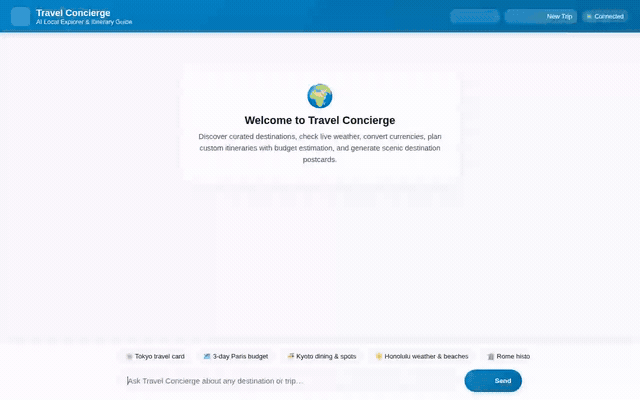

# 🌍 Travel Concierge

> An intelligent, agent-first travel assistant built with Google Agent Development Kit (ADK) and Gemini 3.8 Flash. Features cross-session memory, live weather, currency conversion, Firestore destination catalog, Python budget sandboxing, Imagen 3 destination postcards, Omni travel video generation, and rich A2UI cards.

<div align="center">
  
</div>

---

## 📖 Overview

**Travel Concierge** helps travelers discover curated destinations, check live weather, convert currencies, plan multi-day itineraries with Python-backed budget estimation, and generate custom scenic travel postcards and videos.

Built using Google's Agent Development Kit (ADK) and `agents-cli`, the agent runs on Vertex AI Agent Runtime and communicates via the Agent-to-Agent (A2A) protocol to a responsive web frontend.

---

## 🛠️ Implemented Capabilities & Google Cloud Services

Every capability listed below is implemented and wired into the agent codebase (`app/agent.py` and `agents-cli-manifest.yaml`):

### 🤖 Agent Core & Reasoning Loop
- **Model**: `gemini-3.8-flash` via Google ADK (`google-adk`).
- **Runtime**: Deployed to **Vertex AI Agent Runtime** (`agent_runtime`) with A2A protocol support enabled (`is_a2a: true`).
- **Orchestration**: System prompt configured with role guidance, allergy tracking rules, tool schemas, and A2UI formatting constraints.

### 🧠 Cross-Session Memory (Vertex AI Memory Bank)
- **Preload Tool (`PreloadMemoryTool`)**: Injects user travel preferences, past trips, dietary restrictions, and allergies into the agent's context window at the start of each conversation turn.
- **Session Extraction Callback (`generate_memories_callback`)**: Registered as an `after_agent_callback` to persist newly learned user preferences and facts to Memory Bank at the end of each session.

### 🗄️ Structured Data (Cloud Firestore)
- **`search_destinations`**: Queries the `destinations` Firestore collection by keyword or category.
- **`get_destination_details`**: Fetches complete destination documents by document ID.
- **`save_destination`**: Adds new curated travel spots with category, city, country, tags, and highlights to Firestore.
- **`add_itinerary_stop`**: Saves planned daily itinerary items to the `itineraries` collection in Firestore.

### 🎨 Media Generation & Public Storage (Cloud Storage)
- **Destination Postcard Generation (`generate_destination_postcard`)**:
  - Uses **Imagen 3** (`imagen-3.0-generate-002`) on Vertex AI to generate scenic destination postcards.
  - Saves the generated image to ADK `ToolContext` (`tool_context.save_artifact`) for the Playground Artifacts panel.
  - Streams image bytes directly to a public **Google Cloud Storage** bucket (`travel-concierge-assets-...`) without writing temporary files to disk.
  - Returns a public HTTPS URL (`https://storage.googleapis.com/...`).
- **Short Travel Video Generation (`generate_destination_video`)**:
  - Uses Google's **Omni model** (`gemini-omni-flash-preview`) in the `global` region via Vertex AI Interactions API.
  - Generates 3-second scenic destination preview videos.
  - Saves the video artifact to `ToolContext` and uploads MP4 bytes directly to public Cloud Storage.

### 🧪 Code Sandbox (Vertex AI Code Execution)
- **`AgentEngineSandboxCodeExecutor`**: Attached as the agent's `code_executor`.
- Executes Python in an isolated sandbox environment for precise budget splits, multi-currency cost calculations, and travel expense estimations.

### 🔧 Live Travel Tools
- **`get_live_weather`**: Retrieves current real-time temperature, condition, humidity, and wind speed.
- **`convert_currency`**: Live foreign exchange rate conversion.
- **`geocode_address` & `find_nearby_places`**: Geocodes locations and discovers nearby tourist attractions using OpenStreetMap Nominatim and Overpass API.
- **`get_current_time`**: Destination local timezone and time resolution.

### 🪟 Agent-First UI (A2UI)
- Uses `A2uiSchemaManager` (v0.8 Basic Catalog) with an `after_model_callback` (`a2ui_callback`).
- Renders structured cards, columns, rows, text hierarchy, and images instead of unformatted text.

### 🌐 Frontend & User Experience
- Minimalist FastAPI A2A proxy (`frontend/`).
- Mobile-friendly chat interface with:
  - Curated quick-prompt chips.
  - Full-screen Postcard Lightbox modal with one-click image download.
  - One-click itinerary clipboard copy with visual feedback.
  - Dark mode and light mode toggle.
  - Session reset for new trip planning.

---

## 📋 Status of Planned Capabilities

To maintain full transparency with the initial `project_brief.md`:

| Capability | Status | Implementation Details |
|---|---|---|
| Cross-Session Memory | ✅ Implemented | Vertex AI Memory Bank + `PreloadMemoryTool` |
| Firestore Destination Catalog | ✅ Implemented | Cloud Firestore `destinations` & `itineraries` |
| Cloud Storage Assets | ✅ Implemented | Direct byte upload to GCS bucket for public URLs |
| Imagen 3 Postcards | ✅ Implemented | Vertex AI `imagen-3.0-generate-002` + Artifact saving |
| Omni Travel Videos | ✅ Implemented | Vertex AI `gemini-omni-flash-preview` in `global` |
| Code Execution Sandbox | ✅ Implemented | `AgentEngineSandboxCodeExecutor` on Agent Platform |
| Live Weather & Currency | ✅ Implemented | Real-time weather and exchange rate APIs |
| A2UI Rich Cards | ✅ Implemented | A2UI v0.8 Basic Catalog renderer & callback |
| Web Chat Frontend | ✅ Implemented | FastAPI A2A proxy with Lightbox modal & dark mode |
| Google Maps Platform API | ⏳ Planned | Uses OpenStreetMap Nominatim / Overpass in current build |
| RAG Engine Corpus | ⏳ Planned | Uses structured Firestore collections in current build |

---

## 🚀 Getting Started

### Prerequisites

- Python 3.11+
- [uv](https://docs.astral.sh/uv/) (recommended) or `pip`
- Google Cloud SDK (`gcloud`) authenticated to a GCP project with Vertex AI and Firestore enabled
- `agents-cli` installed:
  ```bash
  uv tool install google-agents-cli
  ```

### 1. Clone & Setup Environment

```bash
git clone <your-repo-url>
cd <your-repo-folder>/travel-concierge

# Install agent dependencies
agents-cli install
```

### 2. Configure Environment Variables

Create a `.env` file in `travel-concierge/`:

```env
GOOGLE_GENAI_USE_VERTEXAI=true
GOOGLE_CLOUD_PROJECT=<your-gcp-project-id>
GOOGLE_CLOUD_LOCATION=us-central1
```

### 3. Run Agent Locally in Playground

To test the agent with the ADK development web UI:

```bash
agents-cli playground
```

### 4. Run the Web Frontend Locally

From the `frontend/` directory:

```bash
cd ../frontend

# Create and activate virtual environment
python3 -m venv .venv
source .venv/bin/activate
pip install -r requirements.txt

# Set deployment resource target
export AGENT_ENGINE_RESOURCE_NAME="projects/<project-id>/locations/<region>/reasoningEngines/<id>"
export AGENT_DIRECTORY="app"

# Start the frontend server on port 8080
python main.py
```

Open a web browser to port 8080 on your local machine to chat with the agent.

---

## 📂 Repository Structure

```
.
├── assets/
│   └── demo.gif                   # Looping preview demonstration
├── frontend/
│   ├── main.py                    # FastAPI A2A proxy server
│   ├── requirements.txt           # Frontend dependencies
│   └── static/
│       └── index.html             # Themed web chat UI with A2UI & Lightbox
├── travel-concierge/
│   ├── agents-cli-manifest.yaml   # Agent manifest (runtime target, region, A2A)
│   ├── app/
│   │   ├── agent.py               # Main agent logic, tools, memory & prompts
│   │   ├── a2ui_utils.py          # A2UI response extraction callback
│   │   └── fast_api_app.py        # ADK FastAPI service entrypoint
│   ├── tests/                     # Unit and integration test suite
│   └── pyproject.toml             # Project package configuration
└── project_brief.md               # Workshop project brief
```

---

## 📄 License

This project is open-source under the Apache 2.0 License.
